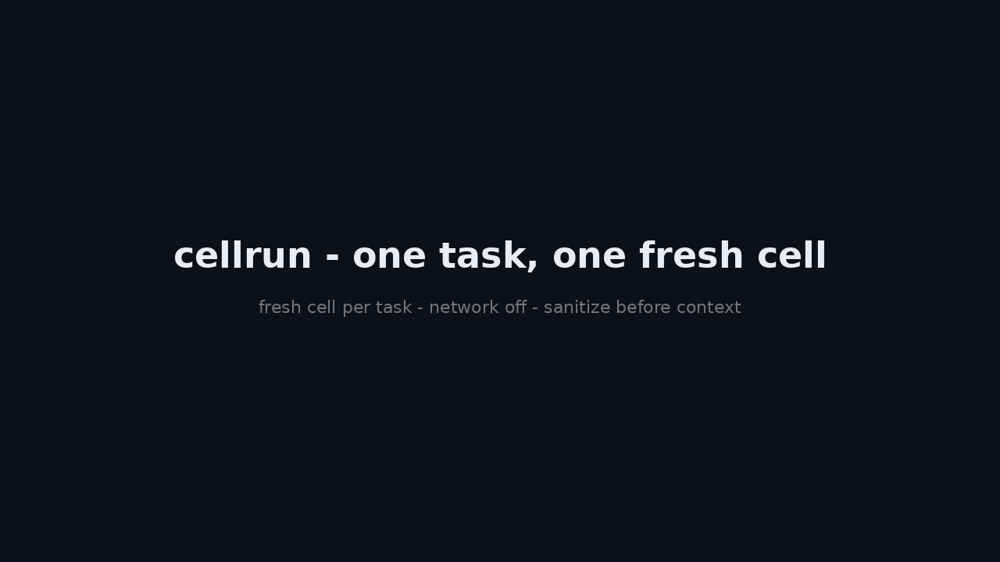

# cellrun

**One task, one fresh cell.** Run an agent task in a disposable directory
with a scrubbed environment and the network off by default, then destroy
the cell. Sanitize tool / MCP / web output for instruction injection
before it enters agent context. Every run leaves an audit record.

Install from source for now — the npm package is not published yet.

```bash
git clone https://github.com/techdevfun/cellrun.git
cd cellrun
npm install
npm run build
npm link   # or run it directly: node dist/cli.js

# Run a task in a fresh cell (network off, env scrubbed, cell destroyed on exit)
cellrun run -- node -e "console.log('hello from a cell')"

# Scan tool output for instruction injection before trusting it
cellrun sanitize report.json        # exit 1 on HIGH findings

# Refuse to run when the input is hostile
cellrun run --sanitize report.json -- node agent-task.js

# See what ran, and whether the network was actually enforced
cellrun cells
cellrun audit
```

## Why

Two things broke in the same week: a Firecracker VM escape showed the
isolation layer can fail, and agent reports were caught claiming files
they never opened. The lesson is the same in both cases - **a prompt is
not a control, and a report is not evidence**.

cellrun is the small, mechanical answer for a single task:

1. **A fresh cell per task.** New temporary directory, environment
   scrubbed to an explicit allowlist (`PATH`, `TERM`, `LANG`, `LC_*`,
   `TZ`, `USER`, `LOGNAME`), `HOME` and `TMPDIR` remapped inside the
   cell. Secrets from the host environment - API keys, tokens, cloud
   credentials - never enter the cell unless you add one back
   explicitly with `--env KEY=VALUE`.
2. **Network off by default.** On Linux, `--network off` is enforced
   with a user + network + PID namespace (`unshare`); with
   `--backend docker` it is enforced with `--network none`. When the
   OS cannot enforce it, cellrun says so in the output and records
   `networkEnforced: false` in the audit log - it never claims
   enforcement it did not have.
3. **Sanitize before context.** `cellrun sanitize` scans tool / MCP /
   web output for instruction-injection patterns (ignore previous
   instructions, override safety, reveal system prompt, exfiltrate
   credentials, conceal from user) and refuses to run (`--sanitize`)
   when a HIGH finding is present.
4. **Audit across the boundary.** One JSONL line per run in
   `~/.cellrun/audit.jsonl`: cell id, command, backend, network mode
   and whether it was enforced, exit code, files created, sanitize
   findings.

## Commands

```
cellrun run [--network off|proxy|on] [--timeout 300s] [--memory MB]
  [--copy <dir>] [--env KEY=VALUE]... [--isolate namespaces] [--strict]
  [--backend docker] [--image ] [--keep] [--sanitize <file>]
  [--allow-host <host>]... -- <command...>
cellrun sanitize <file> [--quarantine] [--allow-host <host>]... [--format table|json]
cellrun audit [--cell <id>] [--format table|json]
cellrun cells [--format table|json]
```

- `run` - exit code is the task's exit code; `124` on timeout.
  The cell directory is destroyed on exit unless `--keep` is given.
- `sanitize` - exit `1` when any HIGH finding exists, `0` otherwise.
  MEDIUM findings (generic imperatives, `curl | sh`, external URLs
  outside `--allow-host`) are warnings only. `--quarantine` writes a
  redacted copy next to the file (`<file>.quarantined`).
- `audit` / `cells` - read the audit log back. `cells` shows live and
  destroyed cells with exit code and age.

### run options

| Flag | Default | Meaning |
| --- | --- | --- |
| `--network off\|proxy\|on` | `off` | Network mode. `proxy` needs `--proxy-url` or `CELLRUN_PROXY_URL`. |
| `--timeout 300s` | `300s` | Kill the task (SIGKILL) after this long; exit `124`. Suffix `s` or `m`. |
| `--memory MB` | none | Virtual-memory limit via `ulimit -v`. See the warning below. |
| `--copy <dir>` | - | Snapshot a project directory into the cell before running. |
| `--env KEY=VALUE` | - | Add a variable back into the cell (explicit, visible). Repeatable. |
| `--isolate namespaces` | - | Linux user + PID namespaces even when the network is on. |
| `--strict` | - | Refuse to run degraded when namespaces are unavailable. |
| `--backend docker` | local | Run inside a container (`--image`, default `node:22-slim`). Fails closed (exit 2) when Docker is missing. |
| `--keep` | - | Keep the cell directory after the task ends. |
| `--sanitize <file>` | - | Scan a file first; refuse the run on HIGH findings. |
| `--allow-host <host>` | - | Hosts that are not flagged as external URLs. Repeatable. |

### The `--memory` warning

`ulimit -v` counts **virtual** memory, and Node needs about 2 GB of
address space just to start. A `--memory` value below 2048 will break
Node tasks outright (the process dies at startup, exit 2). The flag
is opt-in for that reason, and values below 2048 print a warning. The
limit is a guardrail against runaway allocation, not a sandbox.

## Where rivals beat us

| Tool | What it does better | What cellrun does differently |
| --- | --- | --- |
| [devvm](https://devvm.dev) | One VM per project folder, project folder read-write, `--clone` mode, network tiers. Real VM isolation. | cellrun is one **cell per task**, not per project: lighter, disposable, no VM image to maintain - but weaker isolation. |
| [agent-vm](https://agent-vm.org) | Disposable VM per project, Lima built in, full VM boundary. | Same trade: a real VM beats a namespace every time. cellrun trades that boundary for zero setup (no hypervisor, no image download) and for the sanitize + audit half, which neither VM tool ships. |

If you need a real security boundary - untrusted code, hostile input,
multi-tenant hosts - use a VM (devvm, agent-vm) or a sandbox runtime
(gVisor, Firecracker). cellrun is for the common case: your own agent,
your own tasks, where the failure mode is a leaked secret or a poisoned
tool result, not a kernel exploit.

## What cellrun is not

- **Not a sandbox.** The cell is a fresh directory with a scrubbed
  environment, not a filesystem jail: the task can still read host
  files outside the cell directory. A mount namespace is on the
  roadmap; today, do not run hostile code in a cell and expect
  containment.
- **Not a judge.** The sanitizer is a pattern list. Novel phrasings
  slip past it, and legitimate docs can trip the MEDIUM patterns.
  HIGH is the gate; MEDIUM is a warning. Treat a clean scan as "no
  known pattern found", not "safe".
- **Not enforced everywhere.** On Linux without user namespaces, or
  on macOS / Windows, `--network off` is best-effort: the environment
  is scrubbed and no proxy is set, but the kernel does not block the
  socket. The audit log records `networkEnforced: false` in that
  case. `--strict` refuses to run degraded; `--backend docker`
  enforces with `--network none` wherever Docker runs.

## Audit log

`~/.cellrun/audit.jsonl` (`CELLRUN_HOME` overrides the directory), one
JSON object per line:

```json
{"cellId":"cell-20261107-150210-a1b2c3","command":"node -e ...","backend":"local","network":"off","networkEnforced":true,"exitCode":0,"timedOut":false,"filesCreated":["out.txt"],"sanitizeFindings":[]}
```

## Demo



Recorded from real runs (`scripts/record-demo.sh` + `scripts/make-gif.py`).

## Development

```bash
npm install
npm run build
npm test            # unit + e2e (Node 20/22)
npm run test:live   # public endpoints only (npm registry, GitHub API)
node scripts/preflight.js   # Rule 7: ASCII English only, no internal names
```

Requires Node >= 20. Zero runtime dependencies.

## License

MIT. See [LICENSE](LICENSE).
